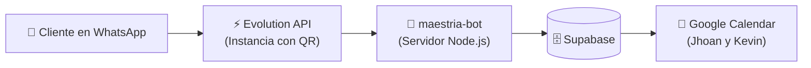

# 🚀 Guía de Despliegue y Puesta en Marcha: maestria-bot

Esta guía te muestra paso a paso cómo dejar funcionando **maestria-bot** conectado al WhatsApp de **Maestría Barbería** (`316 127 7718`).

---

## 📋 Arquitectura del Camino A



---

## 🛠️ Paso 1: Levantar el Servidor de maestria-bot

### Opción Rápida en la Nube (Gratis o muy bajo costo):
Puedes desplegar la carpeta `bot-integration/` en **Railway**, **Render** o en un **VPS**:
1. Conecta tu repositorio de GitHub a [Railway](https://railway.app) o [Render](https://render.com).
2. Selecciona la carpeta raíz del bot: `bot-integration`.
3. Configura las variables de entorno de tu archivo `.env`:
   - `VITE_SUPABASE_URL`
   - `SUPABASE_SERVICE_ROLE_KEY`
   - `EVOLUTION_API_URL`
   - `EVOLUTION_API_KEY`
   - `EVOLUTION_INSTANCE_NAME`
4. Tu servidor te entregará una URL pública segura (ej: `https://maestria-bot.up.railway.app`).

### O probarlo en Local:
```bash
cd bot-integration
npm install
npm run dev
```

---

## ⚡ Paso 2: Conectar WhatsApp con Evolution API

1. **Crear una Instancia en Evolution API:**
   - Nombre de la instancia: `maestria-instance`
   - Token / API Key de autenticación.
2. **Escanear el Código QR:**
   - Abre WhatsApp en el celular de la barbería (`3161277718`).
   - Ve a **Dispositivos vinculados -> Vincular un dispositivo**.
   - Escanea el código QR que genera Evolution API.
   - ¡Listo! Tu número queda conectado 24/7 sin perder la app del celular.

---

## 🔗 Paso 3: Configurar el Webhook en Evolution API

En el panel de Evolution API de tu instancia `maestria-instance`:
1. Activa la opción **Webhook**.
2. **URL del Webhook:**  
   `https://tu-servidor.up.railway.app/webhook/evolution`
3. **Eventos a escuchar:** Marca `MESSAGES_UPSERT`.
4. Guarda los cambios.

---

## 🧪 Paso 4: ¡Hacer la Prueba Real!

1. Desde cualquier otro celular, escribe al WhatsApp de Maestría Barbería:
   > *"Hola"*
2. **maestria-bot** te responderá de inmediato:
   > *"¡Hola! 💈 Soy **maestria-bot**, tu asistente de reservas de **Maestría Barbería**...*  
   > *¿Con quién te gustaría motilarte?*  
   > *1️⃣ Jhoan*  
   > *2️⃣ Kevin*  
   > *3️⃣ Cualquiera disponible"*
3. Sigue el flujo:
   - Elige el barbero (*ej: 2*).
   - Elige el servicio (*ej: 2* para Corte + Barba).
   - Elige la fecha (*ej: 1* para Hoy).
   - Elige la hora (*ej: 1* para las 04:30 PM).
   - Escribe tu nombre (*ej: Juan Pérez*).
   - Confirma con *SÍ*.
4. **Verificación:**
   - El cliente recibe su ticket con código `MAEST-XXXXX`.
   - La cita queda registrada en Supabase en la tabla `citas`.
   - Le pita el celular a Kevin o Jhoan en su Google Calendar con el evento creado.

---

## 🔍 Prueba sin WhatsApp (Test Chat API)
Si quieres probar la lógica del bot directamente en Postman o en la terminal antes de vincular WhatsApp, haz un `POST`:

```bash
curl -X POST http://localhost:3001/api/test-chat \
  -H "Content-Type: application/json" \
  -d '{"phone": "573123456789@s.whatsapp.net", "message": "Hola"}'
```
Devolverá el mensaje inicial de maestria-bot listo para continuar la conversación.
